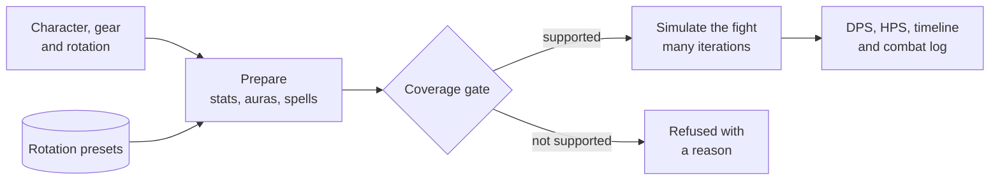
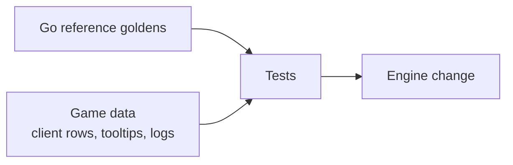

# MythicSim Forever Engine

The simulation engine behind every WoW Forever sim on
[MythicSim](https://mythicsim.com/wow-forever/sim): Quick Sims, stat weights, Best Gear, the
tier, trinket and race boards, the Build Lab and the healer sims. It is written in Rust and
started as a port of [wowsims Forever](https://github.com/ElliotWood/Forever).

## How it works



1. **Prepare.** The request becomes a full character: gear, stats, buffs, talents, spells and
   the rotation to play.
2. **Check.** The coverage gate refuses anything the engine cannot simulate faithfully, with a
   reason, rather than return a wrong number.
3. **Simulate.** The fight runs many times and the results are averaged into DPS (or HPS for
   healers), plus a timeline and combat log of one fight.

## How it is checked



Each mechanic is tested against either the original Go engine's results or the game's own
numbers. [docs/mechanics.md](docs/mechanics.md) records the mechanics checked against game data
and where the engine departs from the reference on purpose.

## Quick start

```sh
git clone https://github.com/sage3648/mythicsim-forever-engine.git
cd mythicsim-forever-engine
cargo test --locked
cargo run --locked --release -- sim --infile fixtures/mage/prepared-v2/frost-reference.prepared.json
```

`sim` runs a fight and prints the result as JSON. `check` with the same arguments lists
anything in the input the engine does not support.

## Rotation presets

Every rotation MythicSim runs is in [`presets/`](presets/README.md), one APL file per rotation.
To propose a better one, open a pull request against its file.

## Repository layout

| Path | Contents |
| --- | --- |
| `src/prepare` | Building a character from a request |
| `src/engine` | Coverage gate and orchestration |
| `src/core`, `src/mechanics` | Fight runtime and shared combat rules |
| `src/classes/<class>` | Class spells, talents and specs |
| `tests`, `fixtures` | Tests and reference inputs and results |
| `presets` | Rotation presets |
| `tools` | Routing, comparison and validation scripts |
| `docs` | Design notes; start with the [contributor guide](docs/contributor-guide.md) |

## Contribute

See [CONTRIBUTING.md](CONTRIBUTING.md) for the checks to run. Open work is on the
[contributor board](https://github.com/sage3648/mythicsim-forever-engine/issues/25).

## License

MIT. Combat rules and RNG derive from [wowsims Forever](https://github.com/ElliotWood/Forever);
see [NOTICE.md](NOTICE.md) and [LICENSE](LICENSE). Not affiliated with Blizzard Entertainment or
the WoW Forever team.
